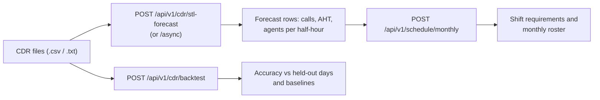
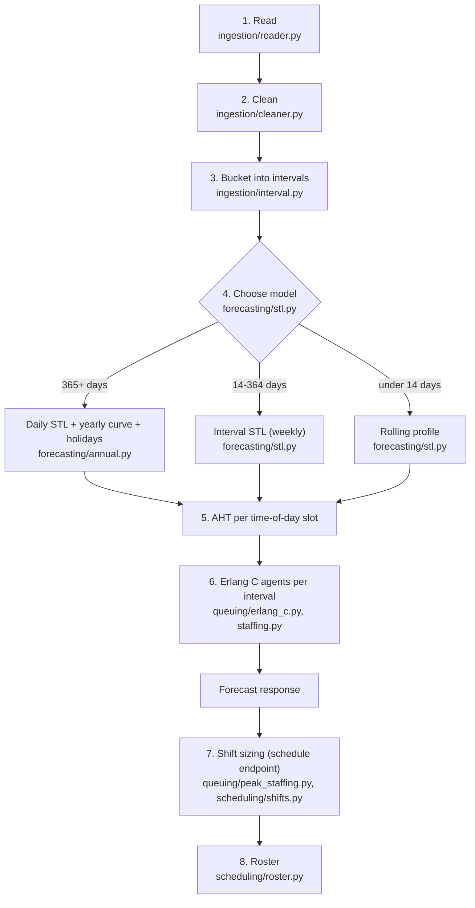
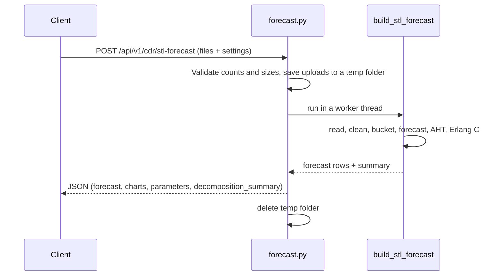
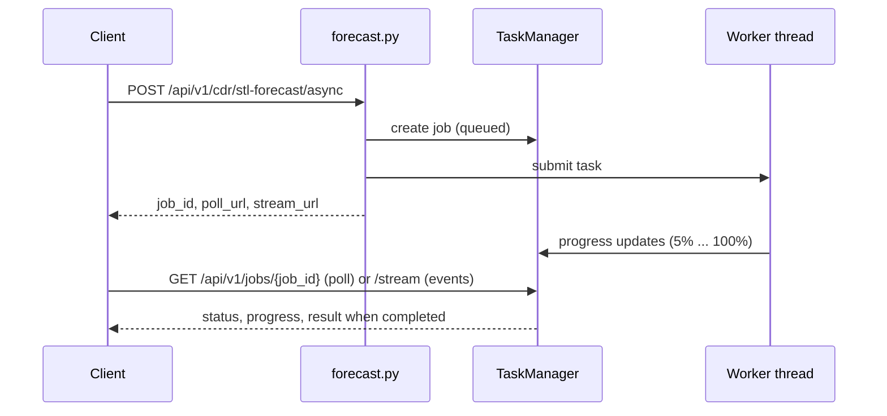
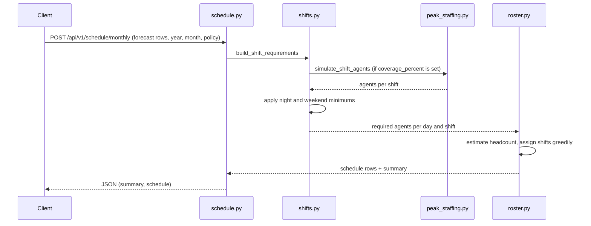

# Architecture, codebase, flow and endpoints

How the service is built, where each piece of the code lives, how a request moves through it, and what every REST endpoint does. For setup and running, see [README.md](README.md). For the forecasting and staffing maths, accuracy and limitations, see [LOGIC_AND_LIMITATIONS.md](LOGIC_AND_LIMITATIONS.md). Field-by-field request and response examples are in [api_documentation.md](api_documentation.md).

Contents: [1. Overview](#1-overview) · [2. Deployment](#2-deployment) · [3. Repository map](#3-repository-map) · [4. Codebase tour](#4-codebase-tour) · [5. Request flows](#5-request-flows) · [6. Data formats](#6-data-formats) · [7. Endpoint reference](#7-endpoint-reference) · [8. Configuration, state and logging](#8-configuration-state-and-logging) · [9. Errors](#9-errors) · [10. Local dashboard](#10-local-dashboard) · [11. Where to change things](#11-where-to-change-things)

## 1. Overview

A single FastAPI service (Python 3.12) that turns historical call-detail records (CDRs) into a call forecast, the agents needed per half-hour, and a monthly roster. It has no database: each request carries its own data and results are returned in the response (or held briefly in memory for background jobs).



The processing pipeline inside the forecast endpoints:



## 2. Deployment

| Item | Detail |
|---|---|
| Packaging | One Docker image (`python:3.12-slim`) that contains only `app/` and the pinned `requirements.txt` |
| Process | `uvicorn app.main:app` with **one** worker on port 8000 |
| Exposure | Published on `127.0.0.1:${APP_PORT:-8000}` only |
| Hardening | Non-root user (UID 10001), read-only root filesystem, all capabilities dropped, `no-new-privileges`, 2 GB memory limit, 256-process limit |
| Storage | `/tmp` is a 512 MiB tmpfs for uploads (deleted after each request); `/app/logs` is a named volume |
| Health | `GET /health`, polled by Docker every 30 seconds |
| Browser pages | `static/` and `backtest-ui/` are **not** in the image. Run locally with Uvicorn for the dashboard, or serve `backtest-ui/` separately |

Why one worker: background jobs and their results live in the memory of the process that started them (see [section 8](#8-configuration-state-and-logging)). More workers or containers would not share them.

## 3. Repository map

```text
.
|-- api.py                          # Compatibility entry point (python -m uvicorn api:app)
|-- app/                            # Everything the Docker image contains
|   |-- main.py                     # App factory: routers, request-ID logging, CORS, optional static files
|   |-- config.py                   # Limits, paths, CORS_ALLOW_ORIGINS
|   |-- logger.py                   # Console + daily rotating file logs
|   |-- api/
|   |   |-- health.py               # GET / and GET /health
|   |   `-- v1/
|   |       |-- router.py           # Mounts the v1 routers under /api/v1
|   |       |-- forecast.py         # /cdr/stl-forecast, /cdr/stl-forecast/async, /cdr/backtest
|   |       |-- jobs.py             # /jobs/{id} and /jobs/{id}/stream
|   |       `-- schedule.py         # /schedule/monthly
|   |-- schemas/schedule.py         # Request model for the schedule endpoint
|   |-- core/
|   |   |-- constants.py            # CDR columns, forecast columns, shift definitions
|   |   |-- ingestion/              # reader.py, cleaner.py, interval.py
|   |   |-- forecasting/            # stl.py, annual.py, calendar.py, backtest.py, aggregates.py
|   |   |-- queuing/                # erlang_c.py, staffing.py, peak_staffing.py
|   |   `-- scheduling/             # shifts.py, roster.py
|   `-- workers/                    # task_manager.py (in-memory jobs), jobs.py (forecast worker)
|-- static/index.html               # Local dashboard (not in the image)
|-- backtest-ui/                    # Backtest and drill-down pages (not in the image)
|-- tools/                          # Command-line helpers (not in the image), see section 4.7
|-- Dockerfile, compose.yaml, .dockerignore, .env.example
|-- requirements.txt                # Pinned dependencies
|-- README.md, ARCHITECTURE.md, LOGIC_AND_LIMITATIONS.md, api_documentation.md
`-- testdata/                       # Git-ignored; local data for the tools
```

## 4. Codebase tour

### 4.1 Application shell

- `app/main.py` builds the FastAPI app, adds a middleware that logs every request with a short ID (returned as `X-Request-ID`), enables CORS only for the origins in `CORS_ALLOW_ORIGINS`, mounts `/static` if the folder exists, and includes the routers.
- `app/config.py` holds the numeric limits and the CORS setting. `app/logger.py` writes to the console and to `logs/app_<date>.log` (daily rotation, 30 files kept).

### 4.2 Ingestion (`app/core/ingestion/`)

| Function | What it does |
|---|---|
| `read_cdr_csv` (`reader.py`) | Tries UTF-16/tab, UTF-8/comma, then Latin-1/comma; accepts a header-style export or the seven-column headerless format and maps both to one internal layout |
| `preprocess_cdr` (`cleaner.py`) | Parses dates and talk time, keeps answered calls with 1 second to 4 hours of talk time, drops rows with missing source or destination |
| `build_cdr_intervals` (`interval.py`) | Counts calls and sums handle time per 15/30/60-minute interval |

### 4.3 Forecasting (`app/core/forecasting/`)

| Module | Role |
|---|---|
| `stl.py` | `build_stl_forecast` is the entry point for all forecasts: reads and cleans the files, builds the interval history, chooses the model, estimates AHT per slot, runs Erlang C and assembles the response. Also holds the weekly interval STL and the rolling-profile fallback |
| `annual.py` | `predict_annual`: daily model with weekly STL, yearly Fourier curve, damped trend, level calibration, holiday multipliers and intraday split. Tunable constants are at the top of the file |
| `calendar.py` | `us_holidays` and the holiday classes (closure, reduced, pre-holiday peak, normal) |
| `backtest.py` | `run_backtest`: trains before a split date, forecasts the rest, scores against the real calls and two naive baselines |
| `aggregates.py` | `build_dashboard_aggregates`: monthly, daily, weekday and time-of-day summaries for charts |

### 4.4 Queuing and staffing (`app/core/queuing/`)

| Module | Role |
|---|---|
| `erlang_c.py` | Traffic, agents required (via `pyworkforce`), service level, occupancy, average speed of answer |
| `staffing.py` | `compute_interval_staffing`: applies `required_agents` to every forecast interval, with an LRU cache keyed on volume, AHT and targets |
| `peak_staffing.py` | `simulate_shift_agents`: simulates each shift many times and returns the agents that cover the requested share of shifts. Fixed seed, numpy only |

### 4.5 Scheduling (`app/core/scheduling/`)

| Module | Role |
|---|---|
| `shifts.py` | `shift_definitions` (three 8-hour shifts, custom start times), `build_shift_requirements` (agents per day and shift; uses `peak_staffing` when `coverage_percent` is set, then applies the night and weekend minimums), `calculate_schedule_headcount` |
| `roster.py` | `build_monthly_agent_schedule`: greedy assignment under the one-shift-per-day, five-days-per-week and eight-hours-rest rules, producing the roster and a coverage summary |

### 4.6 Background jobs (`app/workers/`)

`task_manager.py` keeps a dictionary of jobs (status, progress, message, error, result) behind a lock and runs them on a thread pool of up to 8 threads. `jobs.py` wraps `build_stl_forecast` with progress reporting and removes the temporary upload folder afterwards. State is in memory only.

### 4.7 Tools (`tools/`, not in the image)

| Script | Purpose |
|---|---|
| `smoke_test.py` | End-to-end check of a running API with generated data. Standard library only |
| `shift_coverage_check.py` | Compares old and new staffing: shifts covered, short, extra, on a full year and rolling months |
| `build_comparison_page.py` + `comparison_template.html` | Builds one self-contained HTML page: forecast vs real calls, and planned vs needed agents per shift, drillable month to half-hour |
| `multi_year_backtest.py` | Multi-year backtests of the forecaster against baselines |
| `synthesize_queue_years.py`, `combine_queue_months.py` | Build test data from a real year of CDRs |
| `staffing_vs_actual.py`, `clean_attendance.py`, `export_attendance_xls.ps1` | Compare required staffing with attendance records |

## 5. Request flows

### 5.1 Synchronous forecast



### 5.2 Background forecast



### 5.3 Backtest

`POST /api/v1/cdr/backtest` reads the files, keeps records before `train_end` for training, forecasts the days from there to the end of the data, and compares with what really happened. The response has the metrics (interval and daily error, bias), the weekly baseline, a yearly baseline when there is at least a year of training data, and the per-day and per-interval predicted vs actual values.

### 5.4 Monthly schedule



## 6. Data formats

### 6.1 CDR input

Two layouts are accepted, in `.csv` or `.txt`.

**Header-style call export.** Needs a column for each of these (names are case-insensitive):

| Meaning | Accepted column names |
|---|---|
| Call identifier | `Call ID`, `Unique ID` |
| Date and time | `Date`, `Call Datetime`, `Datetime` |
| Caller | `Caller ID`, `Source` |
| Queue | `Queue`, `Destination` |
| Handle time | `Talk time`, `Duration`, `Handle time` |

Handle time can be `HH:MM:SS` or a form such as `00d 00h 11m 09s`. Every row with a positive handle time counts as answered. Other columns are ignored.

**Canonical headerless format**, seven columns in this order: `source, destination, call_datetime, duration, disposition, unique_id, caller_id`. Dates look like `2025-Jan-15 09:42:11 AM`, durations like `00:03:12`, and only `Answered` rows are kept.

**Cleaning.** Rows are dropped for an unparseable date or duration, a missing source or destination, a destination equal to `s`, a disposition other than answered, or a duration outside 1 second to 4 hours. Each file must keep at least one valid call, and the upload as a whole at least one calendar day. Overlapping files are added together, not de-duplicated. Missing dates and intervals are filled with zero calls.

### 6.2 Forecast rows

Each row of `forecast` has: `interval_start` (`YYYY-MM-DDTHH:MM:SS`, no time zone), `date`, `day_of_year`, `month`, `day`, `weekday` (0 = Monday), `weekday_name`, `hour`, `minute`, `call_volume`, `aht_seconds`, `traffic_erlangs`, `raw_agents`, `scheduled_agents`, `service_level_percent`, `probability_waiting_percent`, `occupancy_percent`, `asa_seconds`.

The schedule endpoint needs `interval_start`, `call_volume`, `aht_seconds` and `scheduled_agents` from these rows.

## 7. Endpoint reference

Interactive documentation is served at `/docs` (Swagger) and `/redoc`; the schema at `/openapi.json`.

| Method | Route | Purpose |
|---|---|---|
| `GET` | `/` | Dashboard if `static/` exists, otherwise a small JSON service message (the container) |
| `GET` | `/health` | `{"status":"healthy","version":"4.4.0"}` |
| `POST` | `/api/v1/cdr/stl-forecast` | Forecast and staffing, returned directly |
| `POST` | `/api/v1/cdr/stl-forecast/async` | Same, as a background job |
| `GET` | `/api/v1/jobs/{job_id}` | Job status, progress and, when done, the result |
| `GET` | `/api/v1/jobs/{job_id}/stream` | Progress as server-sent events |
| `POST` | `/api/v1/cdr/backtest` | Accuracy check against held-out days |
| `POST` | `/api/v1/schedule/monthly` | Shift requirements and a monthly roster |

### 7.1 Forecast (sync and async)

`multipart/form-data`.

| Field | Type | Default | Notes |
|---|---|---|---|
| `files` | file, repeated | required | 1-10 non-empty `.csv`/`.txt` files, at most 25 MiB each |
| `interval_minutes` | integer | `30` | Must divide 1440 (for example 15, 30, 60) |
| `forecast_days` | integer | `365` | 1-3650; `365` picks the period automatically (see the logic document) |
| `seasonal_period` | integer | automatic | Weekly cycle in intervals; at least 2 |
| `trend_lookback_days` | integer | `90` | At least 7 |
| `annual_seasonality` | `auto` or `off` | `auto` | `auto` uses the yearly model with 365+ days of history |
| `target_seconds` | number | `20` | Answer-time target |
| `target_service_level` | number | `80` | Percent answered within the target |
| `shrinkage` | number | `30` | Percent of rostered time not available |
| `max_agents` | integer | `1000` | 1-10,000 cap per interval |
| `include_forecast_rows` | boolean | `true` | `false` returns summaries and charts only |

Percent fields accept `80` or `0.8` (values above 1 are divided by 100); exactly 100% is rejected.

Response: `method` (`STL` or `ROLLING_PROFILE`), `forecast` (rows), `charts`, `parameters`, `decomposition_summary` (which model ran and its diagnostics), totals (`total_predicted_calls`, peak interval, maximum agents) and `source_data` (per-file cleaning counts).

```bash
curl -X POST http://127.0.0.1:8000/api/v1/cdr/stl-forecast \
  -F "files=@calls.csv" -F "interval_minutes=30" -F "target_seconds=20" \
  -F "target_service_level=80" -F "shrinkage=30" > forecast.json
```

The async route returns `{"status":"queued","job_id":...,"poll_url":...,"stream_url":...}` at once. Job statuses are `queued`, `processing`, `completed`, `failed`. The polling response carries `result: null` until the job completes; the stream sends progress only, not the result.

### 7.2 Backtest

Same fields as the forecast (without `forecast_days` and `include_forecast_rows`) plus `train_end` (first held-out date, `YYYY-MM-DD`; default 14 days after the first record). Needs at least 7 days of training data, and 14 for STL.

### 7.3 Monthly schedule

JSON body:

| Field | Type | Default | Notes |
|---|---|---|---|
| `forecast` | array | required | 1-40,000 rows from a forecast response (see 6.2) |
| `year`, `month` | integers | required | Month 1-12 |
| `agent_count` | integer or null | automatic | 1-10,000, at least the estimated minimum |
| `shift_start_times` | three `HH:MM` strings | `00:00, 08:00, 16:00` | Eight hours apart, in shift order |
| `coverage_percent` | number or null | `80` | 50-99; share of shifts to cover. `null` uses the largest `scheduled_agents` in each shift |
| `night_minimum_agents` | integer | `3` | Minimum for the night shift; `0` turns it off |
| `weekend_minimum_agents` | integer | `3` | Minimum for Saturday and Sunday day shifts; `0` turns it off |
| `target_seconds`, `target_service_level`, `shrinkage` | numbers | `20`, `80`, `30` | Use the values the forecast was made with |

Response: `schedule` (one row per agent per day: `WORK` with a shift, or `OFF`) and `summary` (`minimum_agents`, `agent_count`, `shifts`, `staffing_policy`, `total_required_shift_assignments`, `coverage_shortage`, `coverage_ok`, and `coverage` per day and shift with `required_agents`, `assigned_agents`, `shortage`). Check `coverage_ok` even on HTTP 200.

```bash
python - <<'EOF' > schedule-request.json
import json
rows = json.load(open("forecast.json"))["forecast"]
print(json.dumps({"forecast": rows, "year": int(rows[0]["interval_start"][:4]), "month": int(rows[0]["interval_start"][5:7])}))
EOF
curl -X POST http://127.0.0.1:8000/api/v1/schedule/monthly \
  -H "Content-Type: application/json" --data-binary "@schedule-request.json"
```

To restore the plain rule used before 4.4.0, send `"coverage_percent": null, "night_minimum_agents": 0, "weekend_minimum_agents": 0`; then only `interval_start` and `scheduled_agents` are needed.

An overnight shift belongs to its start date, and its requirement uses the following day's intervals when supplied. At the edge of the forecast only the intervals present can be used.

## 8. Configuration, state and logging

**Environment variables** (set in `.env`, see `.env.example`):

| Variable | Default | Effect |
|---|---|---|
| `APP_PORT` | `8000` | Host port for the published API |
| `CORS_ALLOW_ORIGINS` | `http://localhost:5500,http://127.0.0.1:5500` | Browser origins allowed to call the API; empty disables cross-origin access |
| `APP_MEM_LIMIT` | `2g` | Container memory limit |

**Limits** are constants in `app/config.py`: 25 MiB per upload, 10 files, 3,650 forecast days, 10,000 agents, 40,000 forecast rows per schedule request, 8 worker threads.

**State.** There is no database. Jobs and their results are kept in the memory of the single process, so they are lost on restart and not shared between processes. Uploaded files exist only for the duration of a request or job.

**Logging.** Every request is logged with a short ID, client address, status and duration; background jobs log their progress and errors. Logs go to the console (collected by Docker with rotation) and to `logs/app_<date>.log` (daily, 30 files kept) in the `app-logs` volume.

## 9. Errors

| Status | Meaning |
|---|---|
| 400 | Bad data or settings: unsupported file, unreadable CDR, invalid forecast settings, a forecast missing columns the schedule needs, insufficient headcount |
| 404 | Unknown job ID |
| 413 | A file over 25 MiB |
| 422 | Request fails validation (wrong type, missing field, out-of-range value) |
| 500 | Unexpected failure |

Errors carry a `detail` message. A background job can end with `status: failed` and an `error` after an HTTP 200 submission. A schedule can return HTTP 200 with `coverage_ok: false`.

## 10. Local dashboard

`static/index.html` is a single-page tool served at `/` when the app runs locally with Uvicorn (the container has no dashboard). It uses Chart.js from a CDN.

1. Upload one or more CDR files, set the answer-time and service-level targets, and create the forecast (it uses the background endpoint and polls every 500 ms).
2. Review the monthly, weekday and time-of-day charts, and inspect a date's staffing in a table that can be grouped by 0.5 to 8 hours.
3. Download the hourly forecast for the whole output year as CSV.
4. Pick a month, optionally enter an available agent count, and generate the monthly schedule. The dashboard sends its current answer-time and service-level inputs with the request and uses the default staffing policy.
5. Review the daily scheduled agents per shift and download them as CSV. Shift start times can be changed; the three shifts must be eight hours apart.

Charts assume a single forecast year. The CSV exports are built in the browser (UTF-8 with BOM) and contain the displayed data.

## 11. Where to change things

| To change | Edit |
|---|---|
| Staffing policy defaults (coverage, minimums) | `app/schemas/schedule.py` (the dashboard and docs follow the schema defaults) |
| How a shift's agents are computed | `app/core/queuing/peak_staffing.py`, `app/core/scheduling/shifts.py` |
| Forecast tuning (trend damping, smoothing, harmonics) | Constants at the top of `app/core/forecasting/annual.py`; re-run `tools/shift_coverage_check.py` afterwards |
| Holidays and their types | `app/core/forecasting/calendar.py` |
| Shift hours | `SHIFT_DEFINITIONS` in `app/core/constants.py` |
| Upload and size limits | `app/config.py` |
| Supported CDR layouts | `app/core/ingestion/reader.py`, `cleaner.py` |
| Version number | `app/__init__.py`, `app/main.py`, `app/api/health.py`, and the docs |
